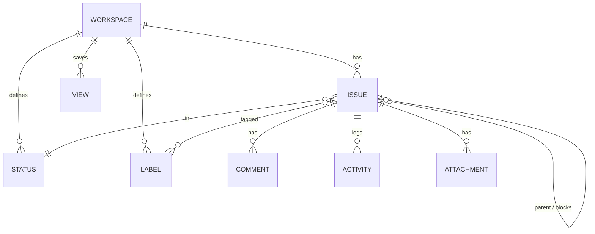

# Bug Tracker (`tracker`): a Linear-style issue tracker as a marketplace app

Status: design (2026-11-09). Placement note: the app itself will live in its
own repository `appthrust/tracker` per
`design/platform/marketplace-apps/first-party-app-repositories.md`; this
directory holds the design until that repository exists, after which the
record moves to `appthrust/tracker/design/README.md` and this copy is deleted.

First target: Project `pj-a167a047c8d3` on the Craftsman estate
(`https://dashboard.platform.craftsman-software.com/dashboard/projects/pj-a167a047c8d3/applications`),
used by the AppThrust team to report and track defects in AppThrust itself.

## Problem

AppThrust defects are today scattered across Linear, Nexus issue notes, and
chat. Reporters inside a customer Project (Craftsman, appthrust.ink) have no
in-product place to file a bug that carries the environment, surface, and
delivered version they observed, and no board to follow it to closure. The
Marketplace already delivers first-party apps (Directory, Memo, Peer Bonus,
Builder Console) with SSO, a database, and a public URL per Project; a tracker
built the same way needs **zero platform changes**.

## Scope

In scope (v1):

- One workspace per installation (= the installing Project).
- Issues with identifier `KEY-n`, title, Markdown description, type, priority,
  status, assignee, labels, due date, parent/child, blocking links; since 0.1.7 the parent link also
  carries epics and user stories (epic › story › work item, [API.md](./API.md)
  "Epics and stories").
- A structured **bug report** form that fills the AppThrust-specific
  `report` fields.
- Comments, attachments (pasted screenshots), and a full activity timeline.
- List and board views, saved views (filters), keyboard-first UI, command
  palette.
- Workspace settings: key, statuses, labels (Team `Admin` only).

Out of scope (v1, revisit in v2): Linear Projects/Cycles, Slack
notifications, GitHub Issue export, anonymous/external intake, SSE push,
custom fields.

## Platform facts this design relies on

| Fact | Source |
| --- | --- |
| A first-party app is its own repository; it produces `ghcr.io/appthrust/<slug>` and the catalog entry; platform never changes. | `design/platform/marketplace-apps/first-party-app-repositories.md` §Domain model |
| Template repository layout: `cmd/server`, `web/`, `catalog/entry.yaml`, `Dockerfile`, `.github/workflows/{ci,publish}.yml`, SDK `github.com/appthrust/appserver-go v0.2.0`. | `appthrust/memo` (README "Source and layout") |
| Entry schema: `components[web-service, postgresql]`, `connections`, `dependencies[]`, `access`, `publish.hostnameLabel`, `releaseIdentityEnvPrefix`, `updatePolicy`, `versions[]`. | `appthrust/peerbonus/catalog/entry.yaml` |
| Runtime env and HTTP contract: `PLATFORM_API_URL`, `PLATFORM_PROJECT_ID`, `PLATFORM_OIDC_ISSUER(_CA_PEM)`, `PLATFORM_ACCESS_ISSUER`, `DATABASE_URL`, `<PREFIX>_PUBLIC_URL`, dependency env, `<PREFIX>_RELEASE_VERSION/_ARTIFACT_DIGEST`; routes `/readyz /healthz /config /releasez /.well-known/appthrust/health`. | `design/platform/marketplace-apps/README.md` §App developer contract |
| Authority is the caller's Team role (`platformclient.Access`) or an Access Key; apps hold no service credential. | same §App developer contract |
| Localized listing / screenshots in the catalog are **not shipped yet**; `display.title/description` is a single English string. | `design/platform/marketplace-apps/catalog-listing.md` (Status: design) |

## Domain model



| Entity | Owner (sole writer) | Lifecycle | Invariants |
| --- | --- | --- | --- |
| **Workspace** | Team Admin via settings | created on first request (one row, id = `PLATFORM_PROJECT_ID`) | `key` matches `^[A-Z][A-Z0-9]{1,5}$`, default `APT`; changing the key renames display identifiers but `issue.number` never changes. |
| **Status** | Team Admin | seeded on workspace creation: Backlog, Todo, In Progress, In Review, Done, Canceled | Every status has exactly one `category ∈ {backlog, unstarted, started, completed, canceled}`; each category keeps ≥ 1 status; a status with issues cannot be deleted (409, move issues first). |
| **Label** | Team Admin | CRUD | unique name per workspace; colour from a fixed palette. |
| **Issue** | any signed-in user | `number` from a per-workspace sequence; soft-deleted by Admin only | `title` 1–200 chars; `description` ≤ 50 KiB Markdown; `type ∈ {epic, story, bug, feature, task}`; an epic has no parent, a story's parent is an epic, a work item's parent is any issue (`domain.ValidateHierarchy`); `priority ∈ {urgent, high, medium, low, none}`; `parent` must not create a cycle; `blocks` is symmetric-stored as `blocked_by`. `report` is present iff `type = bug`. |
| **Report** (embedded in Issue, `jsonb`) | reporter | written on create, editable | `environment` (free label, suggestions: `appthrust.ink`, `craftsman`, `appthrust.dev`, `local`), `surface ∈ {dashboard, platform-api, apth, builder-console, console-app, cluster, other}`, `version` (what the reporter saw on `/releasez`, optional), `steps`, `expected`, `actual` (each ≤ 4 KiB). |
| **Comment** | author; Admin may delete | append | ≤ 20 KiB Markdown; edits keep `edited_at`. |
| **Attachment** | uploader | immutable | `bytea` ≤ 10 MiB, ≤ 10 per issue, `image/png|image/jpeg|image/webp|text/plain|application/json`; served only to signed-in users of the same workspace. |
| **Activity** | server | append-only | one row per changed field (`field, from, to, actor, at`); comments appear in the same timeline by `created_at`. |
| **View** | its creator; shared flag | CRUD | `filter` JSON validated against the filter schema; ≤ 50 per workspace. |

People are OIDC subjects (`sub` from the edge-attached bearer). Display name
and avatar resolve through the `directory` dependency at read time; a missing
person renders as the stored `display_name` snapshot taken at write time.

## Authorization

| Action | Who |
| --- | --- |
| Read everything, create issues/comments/attachments, edit any issue field, create private views | any authenticated user (edge OIDC) |
| Edit/delete own comment, own view | author |
| Delete comments of others, delete issues, manage statuses/labels/key, shared views | Project Team `Admin` (`platformclient.Access(ctx, subject, bearer).Role == Admin`) |

No roles are stored in the app. Access decisions are pure functions
(`domain.Can(actor, action, target)`), table-tested.

## API (`/api/tracker/v1`)

All responses use the SDK `httpx` envelope; errors are `Invalid`,
`NotFound`, `Forbidden`, `Conflict`, `tracker_store_unavailable` (503 while
the database is pending).

| Method & path | Notes |
| --- | --- |
| `GET /workspace` · `PATCH /workspace` | key, name; PATCH Admin only |
| `GET /statuses` · `POST` · `PATCH /statuses/{id}` · `DELETE` · `PUT /statuses/order` | Admin writes |
| `GET /labels` · `POST` · `PATCH /labels/{id}` · `DELETE` | Admin writes |
| `GET /issues?filter=&sort=&cursor=&limit=` | filter = same JSON as View; cursor pagination, `limit ≤ 200` |
| `POST /issues` | returns identifier; `type=bug` requires `report` |
| `GET /issues/{identifier}` | `APT-12` or UUID; includes labels, links, counts |
| `PATCH /issues/{identifier}` | partial; every changed field emits Activity |
| `DELETE /issues/{identifier}` | Admin; soft delete |
| `GET /issues/{id}/timeline` | activities + comments merged, ascending |
| `POST /issues/{id}/comments` · `PATCH /comments/{id}` · `DELETE` | |
| `POST /issues/{id}/attachments` (multipart) · `GET /attachments/{id}` · `DELETE` | `Content-Disposition: inline` for images |
| `GET /views` · `POST` · `PATCH /views/{id}` · `DELETE` | |
| `GET /people?q=` | proxied, cached (60 s) search over Directory; forwards `Authorization` verbatim; tolerates Directory being absent (returns `[]` with `source: unavailable`) |
| `GET /openapi.json` | generated document, as in Memo |

Filter schema (shared by list and View):

```json
{ "status": ["id"], "category": ["started"], "assignee": ["sub" | "me" | "none"],
  "label": ["id"], "type": ["bug"], "priority": ["urgent"], "q": "text",
  "createdAfter": "RFC3339", "environment": ["craftsman"], "surface": ["dashboard"] }
```

## Server layout (`appthrust/tracker`)

```
cmd/server/
  main.go, server.go            flags/env, pending.Serve/Swap, probes, /config, /releasez, static SPA
  internal/domain/              Issue, Status, Report, filter model, transitions, Can(); pure, table-tested
  internal/store/               pgstore.Open + embedded migrations 001_workspace.sql … 006_views.sql
  internal/api/                 handlers, openapi.json, envelope mapping
  internal/directory/           people client (copy of peerbonus/internal/directory)
web/                            Vite + React + TanStack router/query (from appthrust/memo)
catalog/entry.yaml
Dockerfile                      spa-builder (bun build:image) → server-builder → distroless, USER 65532
.github/workflows/ci.yml, publish.yml
```

Environment: `TRACKER_PUBLIC_URL`, `TRACKER_DATABASE_URL` (falls back to
`DATABASE_URL`), `TRACKER_DIRECTORY_URL`, `TRACKER_DIRECTORY_PUBLIC_URL`,
`TRACKER_RELEASE_VERSION`, `TRACKER_ARTIFACT_DIGEST`, `TRACKER_OIDC_AUDIENCES`,
`TRACKER_DEV_SEED=1` (demo data on an empty store), plus the fixed `PLATFORM_*`
set. Unknown or missing database keeps the SPA and probes serving with the API
at 503, never exiting (SDK `pending`).

## Catalog entry

```yaml
apiVersion: appthrust.io/v1alpha1
kind: ApplicationStackDefinition
metadata: { name: tracker }
spec:
  access: { audiences: [appthrust-platform-api], scopes: [openid, profile, email] }
  components:
    - id: web
      definitionRef: { name: web-service, version: v1 }
      defaultValues:
        port: 8080
        minScale: 1
        readinessProbePath: /readyz
        livenessProbePath: /healthz
        publicURLEnv: TRACKER_PUBLIC_URL
    - id: database
      definitionRef: { name: postgresql, version: v1 }
      defaultValues: { provider: CNPG, storageSize: 2Gi }
  connections:
    - { from: web, name: database, to: database }
  dependencies:
    - definition: directory
      installPolicy: Automatic
      urlEnv: TRACKER_DIRECTORY_URL
      publicURLEnv: TRACKER_DIRECTORY_PUBLIC_URL
  display:
    category: collaborate
    title: Issues
    description: Report and track AppThrust defects and work items; Linear-style board, keyboard-first.
    iconRef: { name: tracker }
  publish: { hostnameLabel: tracker }
  releaseIdentityEnvPrefix: TRACKER
  updatePolicy: { default: follow, allowed: [follow, pinned] }
  versions: []        # appended by publish.yml on tag v<semver>
```

Resulting URL on the first target:
`https://tracker.pj-a167a047c8d3.platform.craftsman-software.com`.

Icon: `iconRef.name: tracker` requires the key to exist in the Dashboard
catalog icon set; if it does not at install time the Dashboard falls back to
its generic tile. Adding the icon is the only optional platform touch and is
not a prerequisite.

## UI

- Routes: `/` (list, default view "All issues"), `/board`, `/views/<id>`,
  `/issues/<identifier>` (full page; also opens as a side panel from list),
  `/report` (bug report form), `/settings/{workspace,statuses,labels}`.
- Keyboard: `C` new issue, `Shift+R` report bug, `Cmd/Ctrl+K` palette
  (navigate, change status/assignee/priority/labels on selection), `J/K`
  move, `X` select, `Enter` open, `Esc` close, `/` focus filter.
- List: grouped by status (category order), inline status/priority/assignee
  chips; board: one column per status, drag to change status.
- Bug report form: title, environment (combobox with suggestions),
  surface (select), version (prefilled from `?version=` if the reporter
  arrives via a link), steps/expected/actual, screenshots (paste/drop),
  priority. Creates `type=bug` and lands on the issue.
- Copy via `@appthrust/platform-dashboard-i18n` conventions: Japanese and
  English, language from the Dashboard preference as Memo does.
- Freshness: TanStack Query with optimistic updates and 15 s refetch on
  focus/interval. No websockets in v1.

### Issue panel tabs (v0.1.17)

The side panel showed one issue; opening another replaced it. It now keeps the
issues a person opened as tabs, so several can be compared and returned to.

| Concept | Owner | Lifetime | Invariants |
| --- | --- | --- | --- |
| **Active issue** | the URL (`?issue=<identifier>`, unchanged) | the history entry | the panel is open iff `issue` is set; links, reload and back/forward keep working as before |
| **Open tabs** | the browser tab (`sessionStorage`), not the URL and not the server | until closed or the browser tab ends | ordered, no duplicates (identifiers compared upper-cased), at most 20; the active issue is always one of them |

Open tabs are a person's working set, not part of what a link means: a shared
link opens one issue, never someone else's tab strip.

Rules (pure, `web/src/model/panel-tabs.ts`):

- **Open** (click or `Enter` on a row/card, a link, the palette): the issue
  becomes active; if it has no tab, one is appended to the right of the
  previously active tab. A 21st tab evicts the least recently active one.
- **Browse** (`J`/`K`, arrows while the panel is open): the active tab's issue
  is replaced in place. Walking a list does not leave a trail of tabs.
- **Close a tab** (its ×, middle click, `Esc`): the tab to its right becomes
  active, else the one to its left; closing the only tab closes the panel.
- **Close the panel** (the panel's ×): every tab closes.
- A URL whose `issue` has no tab (deep link, back/forward to a closed issue)
  opens it as a tab. Tabs survive moving between list pages, the board, a
  sprint and the inbox; a page opened without `issue` shows no panel, and the
  next open brings the strip back.
- A tab whose issue was deleted or is unknown shows the not-found state and
  can be closed.

Only the active tab's issue is fetched and rendered; a tab is its identifier
plus the title last seen, so twenty tabs cost nothing until selected.

## Lifecycle

1. Tag `v0.1.0` in `appthrust/tracker` → `publish.yml` builds the image,
   signs, appends `versions[]`, `PUT`s the Cloud catalog entry, waits for
   publication.
2. Each estate's `AppCatalogSource` syncs; `tracker` appears in Marketplace.
3. Install from the Craftsman Project page (Directory installs automatically
   as a dependency if absent).
4. Updates: `follow` (default) rolls new tags on the `0.1` stream; `pinned`
   installations see `UpdateAvailable`.

Preconditions on the Craftsman estate to confirm before publishing
([INFERENCE] both hold because other catalog apps are already listed there):
the estate's `AppCatalogSource` follows the appthrust public catalog, and its
platform version satisfies the entry's `minPlatformVersion` (left unset in
v0.1.0, as the other apps do).

## Verification

- `go test ./...` (domain tables: transitions, cycle detection, `Can`,
  filter parsing, identifier parsing); Postgres-backed store tests opt-in
  via the SDK test database variable.
- `bun run typecheck && bun test` in `web/`; mock server covers every route.
- Two-process smoke: server on loopback with issuer unset (claims trusted),
  local Postgres, `TRACKER_DEV_SEED=1`; drive create → comment → attach →
  status change → timeline with `curl`; SPA pointed at it.
- Post-publish readback on Craftsman: installation `Ready`;
  `GET https://tracker.pj-a167a047c8d3.platform.craftsman-software.com/releasez`
  on a fresh connection reports `0.1.0`; anonymous `curl -sI` → 302 to
  sign-in; one real bug filed through the form by a signed-in user.

## Alternatives considered

- **Linear itself / GitHub Issues** — not in-product; reporters in a customer
  Project have no account; no environment/version capture.
- **Project Addon (`ProjectAddonDefinition`)** — retired; CRDs are retained
  only (`model/charts/model-platform/templates/retained-projectaddondefinitions.tpl`).
- **Teams/Projects/Cycles in v1** — every extra container multiplies filter,
  permission and UI surface; parent/child plus labels covers triage needs.
- **Object storage for attachments** — no storage component in the catalog
  today; `bytea` with a 10 MiB cap holds full-resolution screenshots (an issue
  is at most 100 MiB). Each upload and download is held in memory once.
- **Custom fields instead of a fixed `report` shape** — generic schema engine
  for one use case; the fixed shape keeps filters and the form simple.

## Open questions

1. External (anonymous) bug intake: requires a public route outside the OIDC
   edge and spam controls; deferred until asked.
2. Attachment limits (10 MiB / 10 per issue; 2 MiB until v0.1.16, raised because full-page and high-density screenshots did not fit).
3. Name: slug `tracker`, display "Issues" (ja: 「課題」). Alternative
   `bugtracker` / 「不具合トラッカー」 if the tool stays defect-only.
4. Whether to add the `tracker` icon to the Dashboard icon set (platform PR)
   before or after first publication.

See [implementation-plan.md](./implementation-plan.md) for slices.
